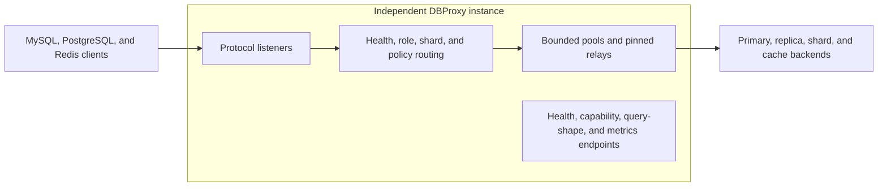

# dbproxy-rs

[](https://github.com/rahulbsw/dbproxy-rs/actions/workflows/ci.yml)
[](https://rahulbsw.github.io/dbproxy-rs/)
[](LICENSE)
[](https://www.rust-lang.org/)

`dbproxy-rs` is a clean-room Rust proxy for MySQL,
PostgreSQL/TimescaleDB, and Redis/Valkey. It provides read/write routing,
health-aware failover, bounded connection pools, sharding, guarded write
fanout, optional MySQL result caching, and Prometheus metrics. The design draws
on operational ideas from Meituan DBProxy and ProxySQL without copying their
GPL-licensed source code.

> [!IMPORTANT]
> This is a pre-1.0 foundation, not a claim of feature parity with mature
> proxies. Review the [current boundaries](#current-boundaries) and test failure
> behavior against your topology before production use.

DBProxy fits between a single database and a distributed database platform. It
routes over a stable topology; it does not replace Vitess fleet automation,
Multigres' PostgreSQL control plane, or Redis Cluster topology management. See
[product positioning](docs/product-positioning.md) for selection and graduation
criteria.

## Protocol and connection model

| Protocol | Proxy behavior | Read/write routing | Sharding | Backend connections |
| --- | --- | --- | --- | --- |
| MySQL | Protocol termination, authentication, TLS upgrade, SQL parsing, prepared statements | Statement-level with transaction and session affinity | Statement key or explicit hint; hash, range, and value | Independent bounded pool per backend |
| PostgreSQL / TimescaleDB | Transparent relay or opt-in simple/common-extended termination | Connection-level or statement-level | Startup-key pinning or parsed SQL rules; hash, range, and value | Pinned transparent sessions or bounded transaction pools |
| Redis / Valkey connection mode | Transparent RESP2/RESP3 relay | Separate read-write and read-only listeners | `DBPROXY.SHARD` connection pinning; hash, range, and value | One selected backend per client connection |
| Redis / Valkey command mode | Bounded parsing and proxy-side key placement | Per-command key and listener role | CRC16 hash tags or stable hash, range, and value; guarded multi-key fanout | One connection per used shard for each client session |

DBProxy instances run independently behind a TCP load balancer. They do not
form a consensus cluster or share session or transaction state. The optional
etcd control plane distributes immutable MySQL policy generations outside the
query path. Existing sessions drain on the generation on which they started.

## Architecture



## Quick start

A running Podman Compose or Docker Compose implementation is required. The
deployer detects either runtime.

```bash
./deploy.sh
./scripts/smoke.sh
./deploy.sh local-down
```

The demo starts MySQL, TimescaleDB, Redis, and DBProxy. The smoke test uses
containerized clients when `mysql`, `psql`, or `redis-cli` is unavailable.
The [quick-start guide](docs/quick-start.md) lists endpoints, credentials, and
expected results. The [deployment guide](docs/deployment.md) covers direct
builds, Kubernetes, overrides, dry runs, and uninstall behavior.

To build from source:

```bash
git clone https://github.com/rahulbsw/dbproxy-rs.git
cd dbproxy-rs
cargo build --locked --release
cp config/dbproxy.example.toml config/dbproxy.toml
export DBPROXY_FRONTEND_PASSWORD='app-secret'
export DBPROXY_BACKEND_PASSWORD='proxy-secret'
cargo run -- --config config/dbproxy.toml --check
cargo run --release -- --config config/dbproxy.toml
```

The copied configuration is ignored by Git. Keep production credentials in an
external secret manager or environment injection, not committed TOML.

## Core behavior

- MySQL terminates the client protocol, supports text and binary prepared
  statements, parses SQL once with `sqlparser-rs`, and shares the AST between
  classification and shard routing.
- PostgreSQL transparent mode preserves extended queries, binary and extension
  types, `COPY`, cancellation, notifications, and unsharded end-to-end TLS.
  Transaction mode terminates supported simple/common-extended traffic for
  statement routing and bounded backend pooling.
- Redis connection mode preserves RESP2/RESP3, transactions, Pub/Sub, Streams,
  scripts, client tracking, AUTH/ACL, and large values. Command mode derives a
  route from command keys and supports a documented fail-closed command set.
- Separate read-write and read-only listeners, weighted replicas, health
  checks, primary fallback, and configurable read-after-write windows protect
  routing consistency.
- MySQL and PostgreSQL transaction pools reset connections before reuse.
  Transactions and unsafe session state pin the exact backend connection.
- Query, result, connection, prepared-statement, fanout, and admin limits bound
  resource use. Deadlines cover client I/O, pool acquisition, backend queries,
  health probes, and graceful shutdown.
- MySQL frontend and backend TLS support certificate verification and optional
  mTLS. PostgreSQL transaction mode supports separately verified frontend and
  backend TLS. Transparent sharded PostgreSQL and Redis require a plaintext
  trusted hop or external TLS termination so DBProxy can read the selector.
- Structured logs omit SQL text, Redis keys and values, credentials, and shard
  key values. Random NanoIDs correlate sessions without becoming Prometheus
  labels.

The [architecture guide](docs/architecture.md) defines routing, consistency,
failure, and security behavior. The [PostgreSQL pooling guide](docs/postgres-pooling.md)
and [Redis topology guide](docs/redis-topology.md) document their protocol-
specific contracts.

## Routing and sharding

Each shard has one primary and may have weighted replicas. Rules map a table
and key column to an ordered shard list:

```toml
[sharding]
enabled = true
default_shard = "orders-0"
missing_key_policy = "reject"
max_scatter_shards = 16
scatter_concurrency = 4

[[sharding.rules]]
table = "orders"
column = "tenant_id"
shards = ["orders-0", "orders-1"]
strategy = "hash"
```

DBProxy parses equality and literal `IN` predicates for configured sharded
tables. It routes all values to one database when they resolve to the same
shard and rejects an ordinary statement that spans shards. The analysis also
inspects CTEs, expression subqueries, DML source tables, and multi-row inserts.
Ambiguous self-joins, shard-key mutations, and unsupported SQL shapes fail
closed.

Root-level `UNION ALL` branches may target different shards. DBProxy executes
them with bounded concurrency, metadata checks, and a shared row and byte
budget. Aggregate-only queries support `COUNT`, arbitrary-precision `SUM`,
weighted `AVG`, and numeric or temporal `MIN` and `MAX`. It rejects global
ordering, grouping, distinctness, windows, cross-shard joins, and nested
cross-shard unions when the required merge semantics are unavailable.

Use `strategy = "range"` for half-open numeric ranges or `strategy = "value"`
for exact mappings. PostgreSQL transaction mode applies the same SQL routing
rules. PostgreSQL transparent mode selects a shard from the startup parameter.
Redis connection mode uses `DBPROXY.SHARD` before AUTH/HELLO; Redis command mode
uses CRC16 hash tags or the configured stable hash and can split only its
explicitly supported multi-key operations.

See the [copy-paste sharding examples](docs/sharding-examples.md) for MySQL,
PostgreSQL/TimescaleDB, and Redis/Valkey hash, range, and value configurations.
The [protocol sharding guide](docs/protocol-sharding.md) defines selectors,
multi-key behavior, and failure rules.

## Fanout, XA, and caching

Non-atomic MySQL write fanout sends allowlisted DML to configured shard
primaries with bounded concurrency. It reports partial completion; it is not a
distributed transaction. Use native replication for identical replicas or an
outbox/CDC pipeline for asynchronous cross-system delivery.

Optional MySQL XA makes allowlisted autocommit DML atomic across the routed and
fanout primaries. DBProxy fsyncs decisions to a single-writer journal and
attempts restart recovery from that journal. XA does not span client
transactions. One coordinator cannot recover another coordinator's locally
owned XIDs. Read the [XA operations guide](docs/mysql-xa.md) before enabling it.

The optional MySQL read-through cache stores explicitly configured results in
Redis/Valkey. It provides bounded values, singleflight fills, refresh-ahead,
and commit-aware table/shard invalidation for writes routed through DBProxy.
Streaming reads and direct database writes bypass that coherence path; use a
bounded TTL or the documented external CDC invalidation contract. See the
[cache guide](docs/cache.md) and [CDC contract](docs/cdc-cache-invalidation.md).

## Operations

The admin listener defaults to `127.0.0.1:6071` and has no application-level
authentication. Keep it on loopback or behind a network policy.

| Endpoint | Purpose |
| --- | --- |
| `/healthz` | Process liveness |
| `/readyz` | Required backend and recovery readiness |
| `/backends`, `/postgres/backends`, `/redis/backends` | Backend role, health, and probe state |
| `/queries`, `/cache/candidates`, `/cache/explain/<query_id>` | Privacy-safe query shapes and cache decisions |
| `/capabilities` | Machine-readable feature status and safety contracts |
| `/metrics` | Prometheus text exposition |

Metrics cover admission, active sessions, routing outcomes, query latency and
limits, pool pressure, backend health, fanout/XA, scatter/gather, caching,
topology refresh, shutdown, and protocol-specific traffic. Labels come from
bounded configured dimensions; they exclude query text, keys, values,
credentials, and per-session IDs. See [operations and metrics](docs/operations.md)
for names, alert suggestions, and the sensitive-data contract.

## Current boundaries

- PostgreSQL transaction mode supports simple queries and common extended-
  query scalar types. `COPY`, unrestricted custom/array/extension types, and
  results that exceed its configured row or byte limits require transparent
  mode.
- PostgreSQL transparent sharding and Redis connection sharding cannot inspect
  selectors inside native end-to-end TLS. Use a trusted plaintext hop or
  external TLS termination. PostgreSQL transaction mode can terminate client
  TLS and establish a separately verified backend TLS or mTLS connection.
- Redis Sentinel discovery updates primaries but does not discover replicas or
  terminate Sentinel TLS. Redis Cluster command mode validates complete slot
  maps and bounded `MOVED`/`ASK` redirects, uses slot primaries for reads, and
  requires directly reachable announced addresses.
- Cross-shard prepared statements require compatible parameter and result
  metadata. Full PostgreSQL cross-shard metadata fingerprinting remains an
  operator-enforced schema contract.
- Streaming cannot resume after a mid-stream backend failure. Once rows have
  reached the client, DBProxy closes the connection because it cannot replace a
  partial result with a clean protocol error.
- Distributed reads remain limited to root `UNION ALL` and the decomposable
  aggregates listed above. Cross-shard joins, ordered/grouped merges, automatic
  table rewriting, and online resharding are not implemented.
- etcd runtime generations cover scoped MySQL users, routing, sharding, fanout,
  and cache policy. Listener, backend, PostgreSQL, Redis, and XA durability
  changes require a restart. There is no admin SQL interface.
- Non-atomic fanout can partially complete. MySQL XA is limited to allowlisted
  autocommit DML and depends on the originating durable journal and participant
  connectivity for recovery.

The [database and network assurance review](docs/review.md) groups current
guarantees and boundaries. [Boundary status](docs/boundary-closure.md) records
the disposition of each constraint, while the [advanced roadmap](docs/advanced-features.md)
defines acceptance gates for unfinished distributed work.

## Documentation

- [Searchable documentation site](https://rahulbsw.github.io/dbproxy-rs/)
- [Documentation index](docs/README.md)
- [Quick start](docs/quick-start.md)
- [Sharding examples](docs/sharding-examples.md)
- [Deployment and Helm](docs/deployment.md)
- [Architecture](docs/architecture.md)
- [Operations and metrics](docs/operations.md)
- [Security policy](SECURITY.md)
- [Contributing](CONTRIBUTING.md)

## Development

Run the complete live protocol and routing suite with a running Podman or
Docker runtime:

```bash
./scripts/integration.sh
```

Run local validation with:

```bash
cargo fmt --check
cargo clippy --all-targets -- -D warnings
cargo test --all-targets
```

The routing benchmark compares the shared single-parse MySQL path with the
former two-parse path. On the recorded development run, the paths measured
10.11 µs and 5.49 µs per operation, a 45.7% reduction. Redis selector parsing
uses SIMD-dispatched `memchr` scanning for RESP boundaries.

The [Helm chart](charts/dbproxy/README.md) deploys independent active-active
data-plane replicas with health probes, disruption protection, hardened pod
settings, separate data/admin services, and optional monitoring and network
policy. It does not create an internally coordinated DBProxy cluster.

## References and license

- [Meituan-Dianping/DBProxy](https://github.com/Meituan-Dianping/DBProxy)
- [ProxySQL documentation](https://proxysql.com/documentation/)
- [sqlparser-rs](https://github.com/apache/datafusion-sqlparser-rs)

The project is licensed under Apache-2.0. Its dependencies retain their own
licenses.
