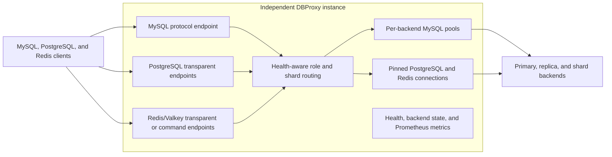

# dbproxy-rs

[](https://github.com/rahulbsw/dbproxy-rs/actions/workflows/ci.yml)
[](LICENSE)
[](https://www.rust-lang.org/)

`dbproxy-rs` is a clean-room Rust database proxy supporting MySQL plus
PostgreSQL/TimescaleDB and Redis/Valkey routing. It adopts useful
operational ideas from Meituan DBProxy and ProxySQL—read/write hostgroups,
weighted replica selection, health-aware failover, SQL filtering, connection
pools, transaction affinity, sharding, guarded write fanout, and metrics—without
copying their GPL-licensed source code.

> [!IMPORTANT]
> This is a pre-1.0 executable foundation, not a claim of one-for-one feature
> parity with mature proxies. Review [current boundaries](#current-boundaries)
> and validate failure behavior against your topology before production use.

New here? Run the [three-command quick start](docs/quick-start.md), then use the
[copy-paste sharding examples](docs/sharding-examples.md) for MySQL,
PostgreSQL/TimescaleDB, and Redis/Valkey.

DBProxy targets the stage between a single database and a full distributed
database platform. It is a lightweight routing layer over an existing,
relatively stable topology—not a replacement for Vitess fleet automation,
Multigres' planned PostgreSQL control plane, or native Redis Cluster topology.
See [product positioning](docs/product-positioning.md) for the selection and
graduation criteria.

## Protocol and connection model

| Protocol | Proxy behavior | Read/write routing | Sharding | Backend connection model |
| --- | --- | --- | --- | --- |
| MySQL | Protocol termination, authentication, TLS upgrade, SQL parsing, prepared statements | Statement-level with transaction and session affinity | Statement key or explicit shard hint; hash, range, and exact value | Independent bounded pool per configured backend |
| PostgreSQL / TimescaleDB | Transparent wire relay, or opt-in simple/common-extended termination with transaction pooling | Connection-level or statement-level read/write routing | Startup-key pinning; hash, range, and exact value | Transparent sessions or bounded per-backend pools |
| Redis / Valkey connection mode | Transparent RESP2/RESP3 relay | Separate read-write and read-only listeners | `DBPROXY.SHARD` connection pinning; hash, range, and exact value | One selected backend connection per client connection |
| Redis / Valkey command mode | Bounded command parsing and proxy-side key placement | Command key and listener role | CRC16 hash tags or stable hash, range, and exact value; guarded multi-key fanout | One connection per used shard for each client session |

DBProxy processes are independent and can run active-active behind a TCP load
balancer. They do not form a consensus cluster or share transaction state. An
optional etcd control plane distributes immutable MySQL routing generations;
etcd is never consulted on the query path, and each transaction drains on the
generation on which its client session started.

## Architecture at a glance



## Documentation

| Guide | Contents |
| --- | --- |
| [Quick start](docs/quick-start.md) | Start, verify, inspect, and stop the complete local demo |
| [Sharding examples](docs/sharding-examples.md) | Copy-paste hash, range, and value configurations and client commands for every protocol |
| [Documentation index](docs/README.md) | Map of guides and configuration examples |
| [Product positioning](docs/product-positioning.md) | DBProxy's scope, alternatives, and graduation to a distributed platform |
| [Deployment](docs/deployment.md) | One-command local and Kubernetes deployment |
| [Architecture](docs/architecture.md) | Data paths, routing, consistency, failure, and security model |
| [Operations and metrics](docs/operations.md) | Readiness, Prometheus metrics, alerts, and capacity tuning |
| [Protocol sharding](docs/protocol-sharding.md) | PostgreSQL, TimescaleDB, Redis, and Valkey routing contracts |
| [MySQL cache](docs/cache.md) | Read-through rules, consistency, failure, and invalidation contracts |
| [Query observatory](docs/query-observatory.md) | Privacy-safe query shapes, cache candidates, and explainability |
| [CDC invalidation contract](docs/cdc-cache-invalidation.md) | Durable direct-write invalidation and lag safety acceptance gates |
| [Shared etcd config](docs/control-plane.md) | Runtime generation scope, security, last-known-good, and draining behavior |
| [Database/network review](docs/review.md) | Correctness review and intentional production boundaries |
| [Advanced roadmap](docs/advanced-features.md) | XA, scatter/gather, online resharding, and acceptance gates |
| [Contributing](CONTRIBUTING.md) | Development workflow and change expectations |
| [Security](SECURITY.md) | Vulnerability reporting and deployment responsibilities |

## What works

- MySQL text protocol and binary prepared statements
- `caching_sha2_password` (default) and `mysql_native_password` frontend
  authentication with per-connection salt
- optional or required frontend TLS using the MySQL protocol TLS upgrade
- per-backend TLS with encrypted-only, CA-verification, hostname-verification,
  and optional client-certificate modes
- MySQL-aware parsing through `sqlparser-rs`
- single-pass SQL analysis shared by classification and shard routing
- hash, numeric-range, or exact-value sharding by integer or string key, with
  one primary/replica group per shard
- shard routing for text and binary prepared statements
- configurable writes to one or more additional shard primaries
- bounded-concurrent fanout to prevent target-count latency from growing
  serially
- conservative primary routing on parse failures and locking reads
- load-aware weighted round-robin across healthy replica pools
- automatic fallback to the primary (configurable)
- backend connection pools with reset-on-return
- optional primary reserved pools isolating transactions and pinned session
  state from ordinary autocommit traffic
- transaction, `USE`, `SET`, and prepared-statement connection affinity
- configurable read-after-write consistency window
- optional bounded Redis/Valkey read-through caching for explicitly configured
  MySQL tables, with singleflight fills and commit-aware invalidation
- SQL substring deny rules and multi-statement rejection
- active backend health checks and automatic recovery
- client/admin admission limits and I/O deadlines
- backend acquisition and query deadlines
- bounded query size, prepared statements, result rows, and result bytes
- configurable buffered or row-by-row streaming result forwarding
- graceful SIGINT/SIGTERM drain with a forced-shutdown deadline
- `/healthz`, `/readyz`, `/backends`, and Prometheus text metrics
- TOML configuration with `${ENVIRONMENT_VARIABLE}` expansion
- transparent PostgreSQL wire forwarding, including simple/extended queries,
  binary types, transactions, cancellation, `COPY`, and unsharded end-to-end TLS
- separate PostgreSQL read-write and read-only endpoints with weighted,
  health-aware backend selection and optional primary fallback
- PostgreSQL/TimescaleDB startup-based connection sharding plus transaction-mode
  SQL-AST routing with equality, `IN`, CTE, bounded `UNION ALL`, and decomposable
  aggregate support using deterministic hash, numeric range, or exact values
- TimescaleDB-transparent hypertables, continuous aggregates, extension
  functions, and high-volume ingest/query traffic
- transparent RESP2/RESP3 Redis/Valkey forwarding with separate read-write and
  read-only listeners, weighted replicas, optional primary fallback, end-to-end
  AUTH/ACL, unsharded TLS passthrough, and streaming of large values
- Redis/Valkey pre-authentication connection sharding through
  `DBPROXY.SHARD`, using the same hash, range, and value strategies
- opt-in Redis/Valkey command routing with CRC16 hash tags, single-shard command
  validation, ordered pipelines, and bounded multi-key fanout/merge
- URL-safe NanoID operation identifiers in MySQL, PostgreSQL, and Redis/Valkey
  routing logs

## Quick start

Start the complete disposable MySQL, TimescaleDB, Redis, and DBProxy demo with
`./deploy.sh`, verify it, and then clean it up. A running Podman Compose or
Docker Compose implementation is required:

```bash
./deploy.sh
./scripts/smoke.sh
./deploy.sh local-down
```

The smoke test uses containerized clients when `mysql`, `psql`, or `redis-cli`
is not installed locally. See the [complete quick start](docs/quick-start.md)
for endpoints and expected results, and the [deployment guide](docs/deployment.md)
for Kubernetes, runtime overrides, dry runs, and uninstall behavior.

To build and configure DBProxy directly instead:

Requirements:

- Rust 1.89 or newer;
- reachable MySQL backend(s);
- Docker Compose or Podman Compose only when running the live integration suite.

Build from source:

```bash
git clone https://github.com/rahulbsw/dbproxy-rs.git
cd dbproxy-rs
cargo build --locked --release
```

Create a local configuration:

```bash
cp config/dbproxy.example.toml config/dbproxy.toml
export DBPROXY_FRONTEND_PASSWORD='app-secret'
export DBPROXY_BACKEND_PASSWORD='proxy-secret'
cargo run -- --config config/dbproxy.toml --check
cargo run --release -- --config config/dbproxy.toml
```

The copied `config/dbproxy.toml` is ignored by Git. Do not store production
credentials in committed TOML; use environment placeholders or your deployment
platform's secret injection.

Connect with a normal MySQL client:

```bash
mysql --protocol=tcp -h 127.0.0.1 -P 6033 -u app -p
```

When PostgreSQL support is enabled:

```bash
psql "host=127.0.0.1 port=6432 user=proxy dbname=app" # read-write
psql "host=127.0.0.1 port=6433 user=proxy dbname=app" # read-only
```

When Redis support is enabled:

```bash
redis-cli -h 127.0.0.1 -p 6380 -a redis-secret # read-write
redis-cli -h 127.0.0.1 -p 6381 -a redis-secret # read-only
```

### TLS

Frontend TLS is configured once for the MySQL listener:

```toml
[proxy.tls]
mode = "required"
cert_path = "/etc/dbproxy/tls/server-chain.pem"
key_path = "/etc/dbproxy/tls/server-key.pem"
```

Use `preferred` during a controlled migration when plaintext clients must still
connect. Use `required` for normal production traffic.

Backend TLS is configured independently for every backend:

```toml
[backends.tls]
mode = "verify_identity"
ca_path = "/etc/dbproxy/tls/mysql-ca.pem"
use_system_roots = false
server_name = "mysql-primary.internal"
# client_cert_path = "/etc/dbproxy/tls/dbproxy-client-chain.pem"
# client_key_path = "/etc/dbproxy/tls/dbproxy-client-key.pem"
```

`required` encrypts traffic without authenticating the backend certificate.
`verify_ca` authenticates the certificate chain, and `verify_identity` also
checks the certificate hostname. Prefer `verify_identity`; reserve `required`
for migrations from legacy MySQL installations.

For result sets larger than the proxy should retain in memory, enable streaming:

```toml
[proxy]
result_mode = "streaming"
max_result_rows = 10000000
max_result_bytes = 4294967296
```

The row and byte limits remain active in both modes. Buffered mode can return a
backend error before sending any result rows. Streaming mode uses bounded
per-row memory, but a backend error or configured limit reached after rows have
started must close the client connection because a complete MySQL error packet
can no longer replace the partial result.

The included Compose topology is useful for protocol and routing smoke tests.
The script auto-detects a running Docker or Podman runtime:

```bash
./scripts/integration.sh
```

The two containerized MySQL nodes are initialized with the same seed data but
are not configured for replication. Use real MySQL replication to test
sustained read/write workloads. Set `DBPROXY_KEEP_CONTAINERS=1` to keep the
integration containers after the script finishes. `DBPROXY_KEEP_DOCKER=1`
remains a backward-compatible alias. To override auto-detection, set
`DBPROXY_COMPOSE="podman-compose"` or `DBPROXY_COMPOSE="docker compose"`.

## PostgreSQL and TimescaleDB

PostgreSQL compatibility has two explicit modes. The default `transparent` mode
does not decode or re-encode traffic, so drivers retain extended queries,
binary and extension types, `COPY`, cancellation, notices, notifications, and
TimescaleDB-specific messages. The opt-in `transaction` mode terminates simple
queries and common-scalar extended queries to pool backend connections and
route each safely parsed statement.

```toml
[postgres]
enabled = true
routing_mode = "transparent" # or "transaction"
read_write_listen = "0.0.0.0:6432"
read_only_listen = "0.0.0.0:6433"
max_connections = 1024
connect_timeout_seconds = 5
query_timeout_seconds = 30
pool_acquire_timeout_seconds = 5
pool_max_per_backend = 32
read_after_write_seconds = 2
max_result_rows = 100000
max_result_bytes = 67108864
shutdown_grace_seconds = 10
fallback_to_primary = true
relay_buffer_bytes = 32768

[[postgres_backends]]
name = "timescale-primary"
address = "timescale-primary.internal:5432"
role = "primary"
weight = 1
# Required only by routing_mode = "transaction".
username = "dbproxy_pool"
password = "${DBPROXY_POSTGRES_POOL_PASSWORD}"
database = "app"

# Optional verified TLS/mTLS for transaction-pool backend connections.
[postgres_backends.tls]
enabled = true
use_webpki_roots = false
ca_path = "/etc/dbproxy/tls/postgres-ca.pem"

[postgres_backends.readiness_probe]
username = "dbproxy_health"
password = "${DBPROXY_POSTGRES_HEALTH_PASSWORD}"
database = "app"

[postgres_backends.readiness_probe.tls]
enabled = true
use_webpki_roots = false
ca_path = "/etc/dbproxy/tls/postgres-ca.pem"

[[postgres_backends]]
name = "timescale-replica"
address = "timescale-replica.internal:5432"
role = "replica"
weight = 2
```

In transparent mode, connections on the read-write listener are pinned to the
primary and read-only connections are distributed across healthy replicas.
Authentication remains end to end. Unsharded mode preserves native end-to-end
TLS; startup-sharded transparent mode needs external TLS termination because
DBProxy must read the selector. An optional
per-backend `readiness_probe` uses a separate least-privilege role to
authenticate and execute `SELECT 1`; omit it to retain TCP-only health checks.
Readiness TLS verifies the certificate chain and the hostname from the backend
address, supports public WebPKI or an explicit CA, and can present a client
certificate for mTLS.

Optional sharding selects a backend shard from `dbproxy.shard_key` in the
StartupMessage or from libpq `options=-c dbproxy.shard_key=<value>`. The private
option is removed before forwarding. See
[docs/protocol-sharding.md](docs/protocol-sharding.md) for hash, range, and
exact-value configurations.

In transaction mode, DBProxy authenticates frontend users from `[[users]]`,
terminates optional frontend TLS, opens independently authenticated/TLS backend
connections, and routes read-only statements to the least-pressured healthy
replica. Writes, transactions, unsafe session state, and the post-write
consistency window use the shard primary. Transactions and session state pin a
backend connection; released connections are reset with `ROLLBACK; DISCARD
ALL`. This mode accepts exactly one parseable statement per simple or extended
query and rejects writes on the read-only listener. Extended parameters and
binary results support common scalar, JSON, numeric, and time types; prepared
statements cache their parsed routing template and inferred parameter metadata,
bind typed values into a short-lived AST for shard selection, and are re-prepared
on the selected pooled backend. `COPY`, custom or
array types, Pub/Sub-like `LISTEN` workflows, and unrestricted extension type
fidelity should use transparent mode. See
[PostgreSQL transaction pooling](docs/postgres-pooling.md).

## Redis and Valkey

Redis and Valkey default to byte-transparent TCP forwarding. In connection mode
DBProxy does not decode or re-encode RESP messages, so RESP2/RESP3, pipelining,
`MULTI`/`EXEC`, Pub/Sub, Streams, Lua scripts, Functions, client tracking, and
large values pass through unchanged.

```toml
[redis]
enabled = true
routing_mode = "connection"
hash_algorithm = "stable_fnv"
read_write_listen = "0.0.0.0:6380"
read_only_listen = "0.0.0.0:6381"
max_connections = 1024
connect_timeout_seconds = 5
shutdown_grace_seconds = 10
fallback_to_primary = true
relay_buffer_bytes = 32768

[[redis_backends]]
name = "redis-primary"
address = "redis-primary.internal:6379"
role = "primary"
weight = 1

[[redis_backends]]
name = "redis-replica"
address = "redis-replica.internal:6379"
role = "replica"
weight = 2
```

Read-write connections are pinned to the configured primary. Read-only
connections use weighted healthy replicas and optionally fall back to the
primary. AUTH/ACL remains end to end. Unsharded mode preserves native TLS
passthrough; sharded mode needs external TLS termination before the plaintext
selector. DBProxy does not store Redis/Valkey credentials.

With sharding enabled, send `DBPROXY.SHARD <value>` as the first plaintext RESP
command, wait for `+OK`, and then authenticate normally. The selected connection
remains pinned to that shard. See
[docs/protocol-sharding.md](docs/protocol-sharding.md).

Set `routing_mode = "command"` to calculate placement from each command's keys.
This mode supports proxy-side CRC16 `{hash-tag}` routing, merges cross-shard
`MGET`, sums cross-shard `EXISTS`/`TOUCH`, and can split
`DEL`/`UNLINK`/`MSET` only when non-atomic cross-shard writes are explicitly
enabled. Commands without a safe built-in key specification are rejected.
On the read-only listener, command mode allows only an explicit read-safe
command set plus connection-local authentication/state commands. Writes,
scripts not declared read-only, and unknown module commands receive a Redis
`READONLY` error before DBProxy opens a backend route.

Optional Sentinel mode requires a configured quorum to agree on each monitored
primary before atomically replacing shard endpoints. Native Redis Cluster mode
requires command routing, computes the 16,384 CRC16 slots, accepts only complete
`CLUSTER SLOTS` snapshots, splits supported multi-key commands by slot, and
follows validated `MOVED`/`ASK` responses with bounded retries and correct
`ASKING` ordering. See [Redis/Valkey topology](docs/redis-topology.md).

Connection mode remains byte-transparent and cannot inspect writes, so Redis
replica read-only mode and ACLs remain its permission boundary. Cluster command
mode currently routes reads through slot primaries; it does not issue `READONLY`
to discovered replicas. Announced node addresses must be directly reachable
from DBProxy.

## Routing behavior

| Query/session state | Destination |
| --- | --- |
| keyed `SELECT` on a sharded table | healthy replica in the selected shard |
| no healthy replica | selected shard's primary when fallback is enabled |
| `SELECT ... FOR UPDATE`, `GET_LOCK`, `LAST_INSERT_ID` | selected shard's primary |
| keyed DML | selected shard's primary, plus configured fanout targets |
| `BEGIN` through `COMMIT`/`ROLLBACK` | one pinned shard-primary connection |
| `SET NAMES`, `SET CHARACTER SET`, `USE` | replayed on each selected backend |
| user variables, locks, SQL-level prepared statements | one pinned shard-primary |
| read inside the configured post-write window | primary |

SQL parsing is deliberately conservative: uncertainty never sends a statement
to a replica.

## Sharding

Backends are grouped by their `shard` value. Every shard must have exactly one
primary and can have zero or more weighted replicas. A rule maps a table and
column to an ordered shard list:

```toml
[sharding]
enabled = true
default_shard = "orders-0"
missing_key_policy = "reject"
max_scatter_shards = 16
scatter_concurrency = 4

[[sharding.rules]]
table = "orders"
column = "tenant_id"
shards = ["orders-0", "orders-1"]
strategy = "hash"
```

`tenant_id = 10` selects `orders-0`; `tenant_id = 11` selects `orders-1`.
Integers use modulo. Strings use stable FNV-1a followed by modulo. Supported
forms include keyed `SELECT`, `UPDATE`, `DELETE`, and `INSERT ... VALUES`.
Equality and literal `IN` predicates are parsed from the SQL AST. Every value
may appear in one statement when all values resolve to the same shard;
otherwise ordinary statements are rejected. CTE predicates are inspected
recursively, as are expression subqueries; every reference must resolve to the
same database. Ambiguous sharded-table self-joins are rejected. Multi-row
inserts must still resolve entirely to one shard. Signed integer literals are
valid range keys. Tuple assignments and conflict updates that include the shard
column are rejected, DML source tables such as `INSERT ... SELECT` are
inspected, and statement families without an implemented shard-key extractor
fail closed when they touch a sharded table.

Top-level `UNION ALL` branches may target different shards and are executed
with bounded concurrency, compatible-column validation, and one shared
row/byte budget. A cross-shard union nested below global `ORDER BY`, `LIMIT`,
`OFFSET`, `DISTINCT`, or another global operation is rejected. Aggregate-only
queries over one sharded table support `COUNT`, `SUM`, weighted `AVG` via
shard-local `SUM`/`COUNT`, and numeric/temporal `MIN`/`MAX`. Grouping, windows,
cross-shard joins, and collation-sensitive string `MIN`/`MAX` remain rejected.

Set `strategy = "range"` or `"value"` and add mappings when modulo/hash is not
the intended data layout:

```toml
[[sharding.rules]]
table = "accounts"
column = "account_id"
shards = ["accounts-low", "accounts-high"]
strategy = "range"

[[sharding.rules.mappings]]
name = "accounts-low"
range_start = 0
range_end = 1000000

[[sharding.rules.mappings]]
name = "accounts-high"
range_start = 1000000
range_end = 2000000
```

Value mappings use `values = ["us-east", "us-west"]`. Ranges are half-open,
and all mapping names must exactly cover the rule's `shards` list.

For an explicitly scoped transaction, select the shard on `BEGIN`:

```sql
/* dbproxy:shard=orders-1 */ BEGIN;
UPDATE orders SET status = 'paid' WHERE tenant_id = 11 AND id = 501;
COMMIT;
```

The hint is also an escape hatch for SQL shapes that cannot be inferred safely.
It must name a configured shard.

## Writing to two or more databases

Write fanout copies matching DML to every configured target shard in addition
to its normally routed primary:

```toml
[write_fanout]
enabled = true
atomic = false
target_shards = ["orders-mirror", "analytics-copy"]
tables = ["orders", "order_items"]
failure_policy = "all"
max_concurrency = 8
```

`failure_policy = "all"` returns an error if any secondary write fails and does
not then execute the routed primary. `best_effort` logs and counts a secondary
failure but continues. Fanout is deliberately rejected inside transactions or
other pinned sessions.

The default `atomic = false` path can partially complete. For allowlisted MySQL
`INSERT`, `UPDATE`, and `DELETE` statements, `atomic = true` uses every selected
primary as an XA participant, fsyncs its decision journal, recovers incomplete
decisions at restart, bounds the participant set, and removes the instance from
readiness while a decision is in doubt. It is rejected inside a client
transaction and cannot be combined with the result cache. The journal must be
on durable, single-writer storage.

See [the MySQL XA operations guide](docs/mysql-xa.md) for configuration,
failure semantics, Kubernetes storage, and application retry rules. Prefer
native replication for identical availability replicas and an outbox/CDC
pipeline for asynchronous cross-system delivery.

See
[`config/dbproxy.sharded.example.toml`](config/dbproxy.sharded.example.toml)
for a complete topology and [the sharding examples](docs/sharding-examples.md)
for client commands, hash/range/value mappings, and failure troubleshooting.

## Operations

The admin listener defaults to `127.0.0.1:6071`:

```text
GET /healthz   process liveness
GET /readyz    primary-backend readiness
GET /backends  backend role and health state
GET /postgres/backends  PostgreSQL transport and configured SQL readiness
GET /redis/backends  Redis backend transport health
GET /queries   bounded privacy-safe normalized query-shape activity
GET /cache/candidates   ranked MySQL result-cache candidates
GET /cache/explain/<query_id>   cacheability reason and counters for one shape
GET /capabilities  machine-readable feature status and safety contracts
GET /metrics   Prometheus text exposition
```

Set `RUST_LOG` to override `logging.filter`. Keep the admin listener on loopback
or behind network policy because it has no application-level authentication.
Logs omit SQL, Redis keys/values, authentication material, and shard-key values;
they can include peer addresses and configured topology metadata. See the
[observability sensitive-data contract](docs/operations.md#sensitive-data-contract)
before exporting logs or metrics outside the cluster.

Readiness begins false and becomes true only after every shard primary passes a
health check. `/backends` includes health timestamps, consecutive failures,
connection attempts, and query failures/timeouts.

Every accepted MySQL, PostgreSQL, and Redis/Valkey session receives a
cryptographically random, URL-safe NanoID operation identifier in structured
logs. These IDs are intentionally excluded from Prometheus labels and do not
rewrite application `INSERT` statements or Redis keys.

Metrics use only bounded labels derived from configured backends, shards, roles,
query kinds, and outcomes. They include:

- client acceptance, rejection, active sessions, I/O timeouts, and duration
- query kind, primary/replica routes, successes, failures, timeouts, rows,
  approximate result bytes, a latency histogram, SQL-analysis duration, and
  conservative parse fallbacks
- replica fallbacks, shard routing failures, prepared statements, and fanout
  attempts/successes/failures/timeouts
- per-backend health state and timestamps, acquisition/query totals and latency
- per-backend pool size, idle/in-use connections, waiters, create failures,
  dirty returns, resets, cleanup errors, and expirations
- PostgreSQL active/accepted/rejected clients, directional wire bytes,
  cancellations, replica fallbacks, backend transport/SQL readiness, and active
  connections
- Redis active/accepted/rejected clients, directional wire bytes, connection
  failures, replica fallbacks, transport health, active connections,
  command-routing/read-only rejections, fanout subcommands, and partial-write
  risk
- admin connection pressure and forced shutdowns

## Performance

The MySQL text path parses each statement once and shares that AST between
classification and shard routing. `cargo bench --bench routing` compares this
path with the former two-parse path. On the development machine used for this
change, the final run measured approximately 10.11 µs versus 5.49 µs per
operation, a roughly 46% reduction in routing time.

Redis shard selection reads bounded chunks into `BytesMut` and uses
SIMD-dispatched `memchr` scanning for RESP line boundaries. Read-ahead bytes
from pipelined commands are retained and forwarded after the selector is
acknowledged.

PostgreSQL and Redis transparent relays use configurable per-direction buffers.
Each connection owns two buffers, so benchmark `relay_buffer_bytes` against
both throughput and aggregate connection memory before increasing it.

See [docs/operations.md](docs/operations.md) for metric names and initial alert
recommendations.

## Current boundaries

- PostgreSQL transaction mode supports simple queries and a bounded set of
  extended-query scalar types. `COPY`, custom/array types, and very large
  result streaming remain on transparent mode
- PostgreSQL/TimescaleDB transparent sharding is startup-selected and native
  end-to-end TLS hides that selector. Transaction mode can route configured
  table keys from SQL while terminating frontend TLS and using a separately
  verified TLS or mTLS backend hop. Typed prepared parameters support the same
  single-shard, root `UNION ALL`, and decomposable aggregate plans as literals
- PostgreSQL readiness defaults to TCP transport. Authenticated SQL probes can
  use certificate/hostname-verified TLS or mTLS; plaintext probes remain an
  explicit trusted-network option
- Redis/Valkey connection sharding requires `DBPROXY.SHARD` before AUTH/HELLO.
  Command mode supports a documented safe command subset, but transactions,
  Pub/Sub, blocking commands, unknown modules, RESP streaming, and payloads
  above configured frame limits must use connection mode
- Sentinel discovery updates primaries only; replica discovery and Sentinel
  TLS are not yet implemented. Cluster mode uses command routing over a
  plaintext trusted hop or external TLS termination and currently uses slot
  primaries for reads
- shard schemas must expose compatible prepared-statement parameter and result
  metadata. Parameterized PostgreSQL Describe uses a shard compatible with the
  requested startup database, but full cross-shard metadata fingerprinting
  remains an operator-enforced schema contract
- streaming result sets are bounded by configured row and byte totals and do not
  support resuming after a mid-stream backend failure
- bounded MySQL and PostgreSQL/TimescaleDB top-level `UNION ALL` and decomposable
  aggregate scatter/gather are implemented; cross-shard joins, grouped/global
  ordered merges, and automatic table rewriting are not implemented. Scatter
  rejects volatile or session-dependent expressions, and exact numeric merges
  use arbitrary precision
- runtime etcd generations currently cover MySQL users, routing, sharding,
  fanout, and cache policy; listener, backend, PostgreSQL, and Redis topology
  changes still require restart, and an admin SQL interface is out of scope
- non-atomic write fanout can report partial completion; opt-in MySQL XA is
  limited to allowlisted autocommit DML and does not span a client transaction

See [docs/architecture.md](docs/architecture.md) for design details.
See [docs/review.md](docs/review.md) for the database/network review and
remaining production boundaries.
See [docs/advanced-features.md](docs/advanced-features.md) for the XA,
scatter/gather, and online-resharding safety plan and acceptance gates.
See [docs/protocol-sharding.md](docs/protocol-sharding.md) for PostgreSQL,
TimescaleDB, Redis, and Valkey sharding configuration and client requirements.
See [docs/boundary-closure.md](docs/boundary-closure.md) for the delivery phases,
acceptance gates, and protocol invariants behind every remaining boundary.

## Kubernetes deployment

The [Helm chart](charts/dbproxy/README.md) deploys at least two independent
active-active pods with rolling updates, health probes, disruption protection,
topology spreading, restricted security contexts, separate data/admin services,
ConfigMap/Secret integration, and optional `ServiceMonitor` and NetworkPolicy.
It also documents aggregate backend connection budgeting. The chart does not
imply an internally coordinated DBProxy cluster: every instance must receive
the same sharding and write-fanout configuration.

## Verification

```bash
cargo fmt --check
cargo clippy --all-targets -- -D warnings
cargo test --all-targets
```

## References

- [Meituan-Dianping/DBProxy](https://github.com/Meituan-Dianping/DBProxy)
- [ProxySQL documentation](https://proxysql.com/documentation/)
- [sqlparser-rs](https://github.com/apache/datafusion-sqlparser-rs)

The project is licensed under Apache-2.0. Its dependencies retain their own
licenses.
