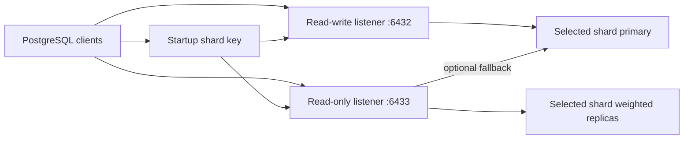
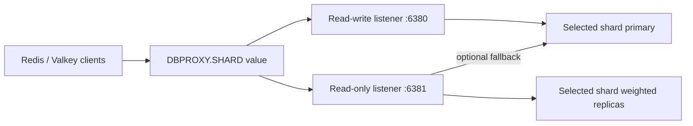
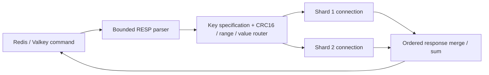
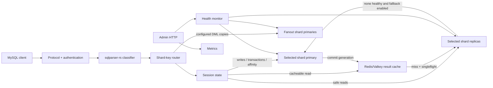
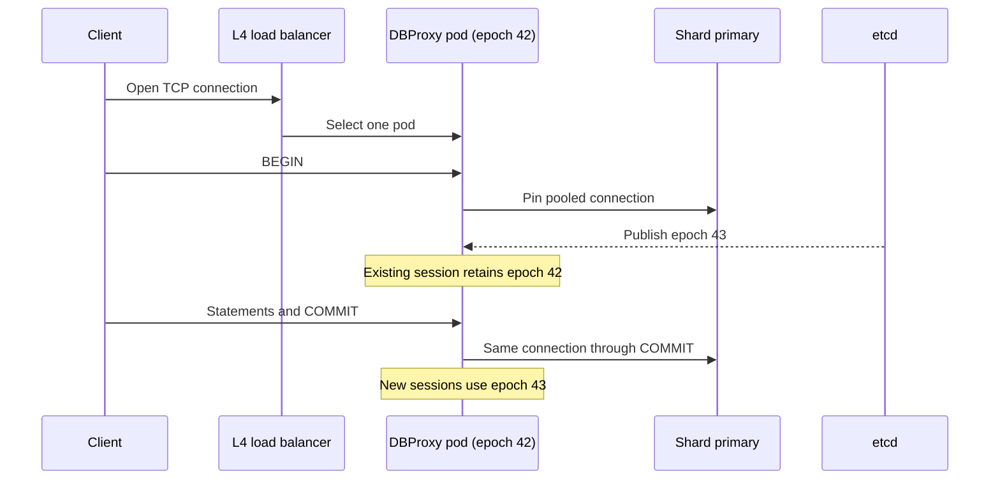

# Architecture

## Protocol listeners

MySQL is protocol-terminated so DBProxy can parse SQL, pool backend
connections, route individual statements, and enforce transaction affinity.
Primary and replica backends already own independent bounded pools. Replica
selection preserves configured weights among similarly loaded pools and avoids
a pool whose in-use-plus-waiter pressure is materially higher than its peers.

PostgreSQL/TimescaleDB is transparent and connection-pinned:

The startup shard key is removed before transparent forwarding, which preserves
the complete PostgreSQL protocol, including
extended queries, binary types, COPY, cancellation, and TLS. The database
performs authentication. A future protocol-terminating mode is required for
transaction pooling or statement-level routing.

Redis connection mode uses the same connection-pinned transport model:

After intercepting the initial shard command, DBProxy does not parse RESP
commands. This preserves pipelines, transactions,
Pub/Sub, RESP3 push messages, scripts, AUTH/ACL, TLS, and arbitrary-size value
streams. It also means the read-only listener is a routing convention rather
than an authorization boundary, and a connection cannot be moved after failover
without losing Redis session state.

Redis command mode is a separate, opt-in path:

Each client owns lazy connections to the shards it uses. Replayable connection
state is applied consistently; commands with unsafe or unknown state semantics
are rejected. On the read-only listener, command mode also rejects writes,
non-read-only scripts, and unknown commands before routing. This enforcement
does not apply to transparent connection mode. Cross-shard writes are opt-in
and explicitly non-atomic.

## Data path

Each frontend client owns a lightweight `ProxySession`. Ordinary text queries
borrow a reset-on-return connection from the selected backend pool. A
transaction or session-affecting operation promotes that client to a pinned
shard-primary connection. This makes transaction and session semantics explicit
and prevents a later statement from silently moving to another server or shard.
Safe deterministic state (`SET NAMES`, `SET CHARACTER SET`, and `USE`) is stored
and replayed on newly selected backend connections instead of pinning the whole
session to the default shard.

## SQL classification

The MySQL dialect parser determines the statement family. Reads are routed to a
replica only when all parsed statements are safe reads. Locking reads,
state-dependent functions, parse failures, and mixed/mutating batches are
primary-only. Multi-statement requests are rejected by default.

The classifier and shard router are separate modules. The shard router extracts
literal equality keys from `SELECT`, `INSERT`, `UPDATE`, and `DELETE`, then uses
the configured hash, half-open numeric range, or exact-value mapping. Hash mode
maps integers by modulo and strings by stable FNV-1a plus modulo. Binary prepared
parameters are bound into a parser-only SQL copy at execute time; the original
statement and typed values are still sent to MySQL.

## Backend selection

Backends are organized into named shards, each with exactly one primary and zero
or more replicas. Replica weights define deterministic weighted rotation within
the selected shard. Unhealthy replicas are removed from selection without
destroying their pools; a successful health check adds them back automatically.

Pools reset connections on return. This costs one backend round trip but stops
transactions, temporary tables, user variables, and prepared statements from
leaking between unrelated clients.

Pool acquisition and backend query execution have separate deadlines. Timed-out
or protocol-uncertain connections are disconnected rather than returned for
reuse. Client reads/writes and admin request lines also have deadlines, and both
listeners enforce independent admission limits.

A primary can configure `reserved_pool`. `BEGIN` and non-replayable session
state acquire from that independent pool, preventing a burst of ordinary
autocommit work from consuming every connection needed to finish existing
transactions. If no reserve is configured, affinity uses the normal primary
pool. Reserved capacity is additive and must be included in database limits.

## Consistency

Three rules prevent the common read/write-split correctness failures:

1. transactions are pinned from `BEGIN` until successful `COMMIT` or `ROLLBACK`;
2. session mutations remain pinned to one shard for the client life;
3. a configurable read-after-write window sends subsequent reads to primary.

The time window is not a substitute for replication-position tracking. A future
GTID-aware mode can replace it without changing the classifier interface.

## Active-active transactions and configuration epochs

An L4 load balancer selects one DBProxy process when a client opens its TCP
connection. That process owns the MySQL protocol session. `BEGIN` pins the
selected shard, primary backend connection, and immutable configuration
generation until `COMMIT` or `ROLLBACK` succeeds.

etcd stores policy, never transaction state. If the pod or its connection dies,
the database rolls back an open transaction and the client must retry the whole
unit of work. DBProxy does not claim transparent transaction resume. The
separate constrained XA path covers only one allowlisted autocommit DML
statement across MySQL fanout participants; it does not distribute this client
transaction.

## Failure model

- SQL uncertainty fails closed to primary.
- With sharding enabled, a missing shard key or unsafe cross-shard shape is
  rejected rather than sent to an arbitrary shard.
- Unavailable replicas fall back to primary only when configured.
- PostgreSQL and Redis transparent sessions are never replayed onto another
  backend after the connection has been established.
- Missing, invalid, or unmapped PostgreSQL/Redis shard values are rejected
  before backend authentication.
- Any unhealthy shard primary makes `/readyz` return HTTP 503.
- Readiness remains false until each primary has completed at least one
  successful health check.
- Default fanout targets execute with bounded concurrency and can partially
  complete. Optional MySQL XA fanout uses a fsynced single-writer journal;
  pre-decision failures abort and post-decision failures remain recoverable.
- Backend errors become MySQL error packets instead of panicking the client
  task.
- Connection admission is bounded before allocating a session.
- Query, result-row, result-byte, and prepared-statement memory pressure is
  bounded by configuration.
- SIGINT/SIGTERM shutdown stops acceptance, drains sessions until the configured
  deadline, then aborts remaining sessions and disconnects pools.

## Security model

MySQL frontend credentials use either caching SHA-2 (the default) or MySQL
native password challenge-response and a unique salt. Configuration supports
environment expansion so secrets need not be committed. PostgreSQL and
Redis/Valkey authentication is passed through. Their native TLS is also passed
through when protocol sharding is disabled.

Sharded transparent modes must expose the shard selector before encryption.
Use external TLS termination on the client-facing hop; unsharded modes continue
to support end-to-end PostgreSQL and Redis/Valkey TLS passthrough.
